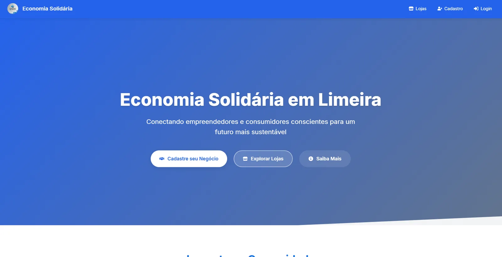

# 🛒 Economia Solidária — Marketplace Local

> 💡 **Nota de Autoria (TCC):** Este repositório reflete o **Projeto de Conclusão de Curso (TCC)** do curso Técnico em Desenvolvimento de Sistemas pelo SENAI, desenvolvido em equipe. Minha contribuição principal e foco técnico foi na **arquitetura do Front-end em React**, **integração com a API** e gerenciamento de estado.

<p align="center">
  <a href="https://economia-solidaria-frontend.vercel.app" target="_blank">
    
  </a>
</p>


## 💻 Sobre o Projeto

Uma plataforma digital desenvolvida para conectar pequenos negócios e serviços locais da cidade com consumidores, promovendo a economia solidária e impulsionando microempreendedores através de tecnologia acessível.

### Funcionalidades Implementadas
- **Autenticação:** Login, registro e perfis separados (consumidor vs. administrador).
- **Gestão de Negócios:** Cadastro de lojas, upload de imagens, categorização e geolocalização.
- **Busca & Descoberta:** Filtros dinâmicos e paginação para consumidores encontrarem serviços.
- **Interface Responsiva:** Design system implementado com Material UI.

## 📸 Tela inicial

<p align="center">
  
</p>

## 🛠️ Stack Utilizada

- **Front-end:** React 18, React Router DOM, Material UI (MUI), Framer Motion, Axios.
- **Autenticação & Storage:** Firebase (Auth, Firestore, Storage).
- **Mapas:** Google Maps API.

*(A arquitetura completa, diagramas UML e fluxogramas originais do TCC estão mantidos na documentação e no diretório `/Diagramas`).*

## ⚙️ Como rodar o front-end

Pré-requisito: Node.js 18 ou mais novo.

```bash
cd economia-solidaria-frontend
npm install
```

Crie o arquivo `economia-solidaria-frontend/.env` com o endereço da API de back-end:

```env
REACT_APP_BACKEND_URL="http://localhost:8000/api"
```

Inicie:

```bash
npm start
```

O site abre em `http://localhost:3000`. O login e os dados das lojas usam o Firebase, já configurado em `src/firebase.js`.

## 🧠 Decisões técnicas do front-end

| Decisão | Por quê |
| :--- | :--- |
| **Firebase (Auth, Firestore e Storage)** | Login, dados das lojas e imagens sem precisar manter um servidor próprio de autenticação e armazenamento. |
| **Rotas protegidas** (`PrivateRoute` e `AdminRoute`) | Só quem está logado vê as telas internas, e só o administrador acessa o painel de administração. |
| **Instância única do Axios** com limite de 10 s e token no cabeçalho | Toda chamada à API passa pelo mesmo ponto, com o token de acesso enviado automaticamente. |
| **Validação de CPF e CNPJ** (`cpf-cnpj-validator`) e máscaras nos formulários | Evita cadastros com documento inválido antes de chegar ao servidor. |
| **Material UI** | Interface consistente e responsiva sem escrever todo o CSS à mão. |
| **Google Maps** (`@react-google-maps/api`) | Mostra a localização das lojas para o consumidor encontrar negócios perto dele. |

## 🔭 Próximos passos

Pontos que eu melhoraria, olhando o código hoje:

- **Não versionar arquivos `.env`** (só um `.env.example` sem valores) e **trocar as chaves** que já foram publicadas.
- **Variável de ambiente para a verificação de CNPJ**, que hoje aponta para um endereço local fixo no código.
- **Testes automatizados** dos formulários e das rotas protegidas, e CI no GitHub.
- **Remover os `console.log` de depuração** do código de produção.
